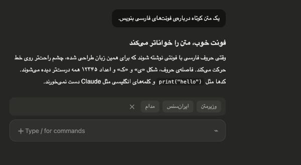
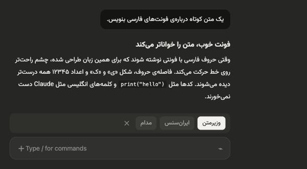
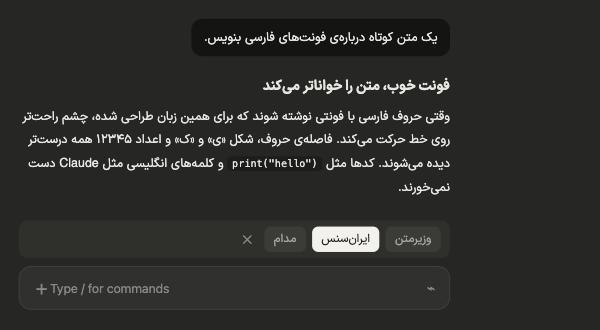
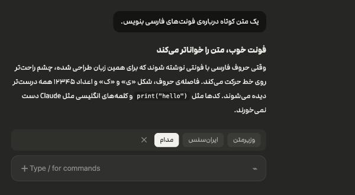

# فونت فارسی برای Claude

اپ دسکتاپ Claude روی مک، متن فارسی را با فونت پیش‌فرض مک نشان می‌دهد که زیبا نیست. این افزونه فونت متن فارسی را عوض می‌کند. فونت **وزیرمتن** همراهش است و هر فونت فارسی دیگری را هم که خودت داشته باشی می‌توانی اضافه کنی.

متن انگلیسی و کدها دست نمی‌خورند و فقط حروف فارسی عوض می‌شوند.

| پیش‌فرض مک (قبل) | وزیرمتن |
| --- | --- |
|  |  |
| **ایران‌سنس** | **مدام** |
|  |  |

<sub>تصویرها نمونه‌اند. ایران‌سنس و مدام فونت‌های پولی‌اند و همراه این مخزن نیستند؛ برای نشان دادن اینکه فونت خودت را هم می‌توانی اضافه کنی آمده‌اند.</sub>

## نصب

### راحت‌ترین راه: به Claude بسپار

لینک همین صفحه را به Claude بده و بگو:

> این را برایم نصب کن: https://github.com/MoAliTheGoat/claude-persian-font

Claude راهنمای نصب را در [`CLAUDE.md`](CLAUDE.md) می‌خواند و انجامش می‌دهد. ایجنت‌های دیگر (Cursor، Codex و…) هم [`AGENTS.md`](AGENTS.md) و [`llms.txt`](llms.txt) را می‌خوانند. بعد از نصب، Claude خودش بلد است فونت را عوض کند؛ کافی است بگویی «فونت فارسی را مدام کن».

### نصب دستی

در اپ دسکتاپ Claude، کنار جعبه‌ی پیام روی **+** بزن، بعد **Plugins**، بعد **Add marketplace** و این را بنویس:

```
MoAliTheGoat/claude-persian-font
```

بعد **persian-font** را اضافه کن.

یا در ترمینال، داخل Claude Code:

```
/plugin marketplace add MoAliTheGoat/claude-persian-font
/plugin install persian-font@claude-persian-font
```

بعد از نصب، Claude را یک بار ببند و دوباره باز کن.

## استفاده

بالای جعبه‌ی پیام یک دکمه‌ی کوچک **«Aa وزیرمتن»** هست. رویش بزن تا فونت‌ها باز شوند. هر کدام را انتخاب کنی، Claude چند ثانیه بسته و دوباره باز می‌شود. Claude فونت‌ها را فقط موقع باز شدن می‌خواند. اگر نوار را نمی‌خواهی، در فهرست باز شده **«پنهان کن»** را بزن؛ فونت انتخابی سر جایش می‌ماند. برای برگرداندن نوار، در جعبه‌ی پیام بنویس `/persian-font`.

## افزودن فونت خودت

فایل‌های فونت (`.ttf` یا `.otf`) را در یک پوشه به اسم همان فونت بگذار:

```
~/.claude-persian-font/fonts/<اسم فونت>/
```

مثلاً `~/.claude-persian-font/fonts/IRANSans/IRANSans-Regular.ttf`. بهتر است وزن‌های معمولی و پررنگ را هر دو بگذاری. بعد از باز شدن دوباره‌ی Claude، فونت در فهرست می‌آید. فونت‌های پولی را باید خودت تهیه کنی؛ این مخزن فقط وزیرمتن را دارد.

## چطور کار می‌کند

Claude در فهرست فونت‌هایش، پیش از فونت‌های مک که فارسی را زشت نشان می‌دهند، اسم چند فونت ویندوزی را آورده است که روی مک نیستند. این افزونه یک نسخه از فونت انتخابی‌ات را، فقط با حروف فارسی، به همان اسم‌ها روی مک نصب می‌کند. این فایل‌ها در `~/Library/Fonts` با اسم `*ClaudeFa*` ذخیره می‌شوند. خودِ برنامه‌ی Claude دست نمی‌خورد.

## ویندوز (فقط متنِ جواب‌های Claude)

روی ویندوز فقط **متن جواب‌های Claude** را می‌شود با وزیرمتن نشان داد. منوها و پیام‌های خودت با فونت ویندوز (Segoe UI) می‌مانند، چون Claude آن فونت را پیش از هر فونت دیگری برمی‌دارد و ویندوز هم حروف فارسی دارد. این روش روی یک ویندوزِ واقعی (ماشین‌های آزمایشی گیت‌هاب) آزمایش شده است: پس از نصب، متن جواب‌ها با وزیرمتن و پس از حذف دوباره با فونت ویندوز نشان داده شد.

در PowerShell (بدون نیاز به دسترسی ادمین):

```powershell
irm https://raw.githubusercontent.com/MoAliTheGoat/claude-persian-font/main/windows/install.ps1 | iex
```

بعد Claude را کامل ببند (از آیکون کنار ساعت هم) و دوباره باز کن. اگر در تنظیمات Claude فونت جواب‌ها (Response font) را عوض کرده‌ای، روی پیش‌فرض بگذار. برای برگرداندن، `windows/uninstall.ps1` را به همین شکل اجرا کن.

## محدودیت‌ها و ایرادهای شناخته‌شده

- **با هر بار عوض کردن فونت، Claude یک بار بسته و باز می‌شود.** Claude فونت‌ها را فقط موقع باز شدن می‌خواند و تا دوباره باز نشود، فونت قبلی را نگه می‌دارد. افزونه این کار را خودکار انجام می‌دهد و گفتگوها سر جایشان می‌مانند، ولی چند ثانیه طول می‌کشد.
- **فونت‌ها در منوی خودِ Claude (Settings → Appearance → Interface font) نمی‌آیند.** آن منو مال خودِ Claude است و راهی برای افزودن گزینه به آن نیست. تنها راه، ساختن نسخه‌ی تغییریافته از خودِ برنامه است. آن راه را امتحان کردیم و کار هم کرد، اما امضای Anthropic از بین می‌رفت. نتیجه این می‌شد که مک بار اول رمز می‌خواست و به‌روزرسانیِ خودکار هم از کار می‌افتاد. برای همین کنار گذاشته شد.
- **دکمه‌ی فونت فقط بالای جعبه‌ی پیام می‌تواند باشد.** کادر دورش را خودِ Claude می‌کشد و نمی‌شود کوچک‌ترش کرد یا جای دیگری، مثلاً کنار میکروفون یا نوار بالا، گذاشتش.
- **اسم‌های قرضی:** فونت فارسی با اسم دو فونت ویندوزی («Segoe UI» و «Noto Sans Hebrew») روی مک نصب می‌شود. اگر سایتی در کروم یا سافاری همین اسم‌ها را بخواهد، حروف فارسی‌اش هم با فونت تو نشان داده می‌شود. حروف انگلیسی دست نمی‌خورند.
- **ویندوز:** فقط جواب‌های Claude عوض می‌شوند، نه منوها و پیام‌های خودت و روی ویندوز به‌صورت خودکار آزمایش شده است، نه داخل خودِ اپ Claude. انتخاب فونت از داخل برنامه هم روی ویندوز نیست و فقط وزیرمتن نصب می‌شود. لینوکس امتحان نشده است.
- اگر Claude موقع بسته شدن چیزی بپرسد (مثلاً «کاری در جریان است، ببندم؟»)، باز شدنِ خودکار انجام نمی‌شود. در این حالت خودت دوباره بازش کن.

## برگرداندن

```bash
python3 "$(find ~/.claude/plugins -path '*persian-font*' -name fontswitch.py | head -1)" off
```

یا فایل‌های `*ClaudeFa*` را از `~/Library/Fonts` پاک کن. بعد افزونه را از بخش Plugins حذف کن.

## نیازمندی‌ها

- macOS و اپ دسکتاپ Claude
- `python3` (اگر نصب نیست، مک خودش پیشنهاد نصبش را می‌دهد). کتابخانه‌ی `fonttools` بار اول خودکار نصب می‌شود.

---

## English

Makes the Claude desktop app on macOS draw Persian text in a font you choose. Vazirmatn is bundled; drop your own `.ttf`/`.otf` files in `~/.claude-persian-font/fonts/<Font Name>/` to add more. Latin text and code are untouched.

Install: in the desktop app, **+** → **Plugins** → **Add marketplace** → `MoAliTheGoat/claude-persian-font`, then add **persian-font**. Or in Claude Code:

```
/plugin marketplace add MoAliTheGoat/claude-persian-font
/plugin install persian-font@claude-persian-font
```

Restart Claude once. Pick a font from the small **Aa** button above the message box; Claude restarts itself to load it. **Hide** (پنهان کن) removes the bar and keeps your font; `/persian-font` brings it back.

How: Claude's font stacks list Windows fonts ("Segoe UI", "Noto Sans Hebrew") ahead of the Mac fonts that render Persian poorly. This installs a Persian-only subset of your chosen font under those names in `~/Library/Fonts` (`*ClaudeFa*`). The app itself is not modified.

Known limitations: Claude must restart for every font change (it reads fonts only at launch; the plugin restarts it for you). The fonts can't appear in Claude's own Settings → Interface font menu without patching the app, which breaks Anthropic's signature (keychain prompt, no auto-updates), so we don't. The button can only live above the message box. The borrowed names ("Segoe UI", "Noto Sans Hebrew") also affect Persian letters on websites that request those fonts. Windows: `irm https://raw.githubusercontent.com/MoAliTheGoat/claude-persian-font/main/windows/install.ps1 | iex` sets Vazirmatn for Claude's replies only (the UI keeps Segoe UI, which Windows lists first); tested automatically on Windows (GitHub Actions, Edge engine with Claude's font stacks), not inside the Claude app itself.

## License

Code: MIT. Vazirmatn: SIL Open Font License 1.1 (`fonts/Vazirmatn/OFL.txt`), by the Vazirmatn Project Authors.
